# State machines of the extension

**At a glance.** This document catalogues the extension's state machines in four areas: download, cloud, clear, and overlay. Each machine has its business context, a diagram, a transition table, and the code that implements it. An audit on 2026-11-16 fixed 22 reachable invalid states or transitions, 18 of them with regression tests, and section 7 lists the 29 findings that stay open.

This document describes the current code. Line numbers point at the working copy of 2026-11-16.

## 1. How to read this document

- **Explicit machine**: the code names the states in a type, for example `JobStatus`.
- **Implicit machine**: the state is spread over maps, flags, timers, or storage keys. The document names the states.
- **Invariant**: a statement that must hold in every reachable state.
- **Violation**: a reachable state or transition that breaks an invariant.
- A table row reads: in state *From*, event *Event* moves to *To*, when *Guard* holds.
- A code block quotes the source file unchanged. The heading above it names the file and first line.

Status words in sections 6 and 7:

| Status | Meaning |
|---|---|
| Fixed, tested | The fix has a regression test that failed before the fix. |
| Fixed, untested | The fix is in shell code that has no test seam. |
| Open, decision | The code and an ADR or a test disagree. The owner must choose. |
| Open, work | A confirmed defect that is not fixed yet. |
| Open, plausible | The path is reachable by reading, but no test reproduces it. |

## 2. Download machines

Owner files: `src/entrypoints/background.ts`, `src/packages/download/`, `src/background/transfer-correlation.ts`.

### 2.1 Request bookkeeping (implicit)

**Business context.** The user clicks save on a photo or video. The extension must not start the same media twice while the first save still runs. This machine is the "already saving" memory that refuses the duplicate.

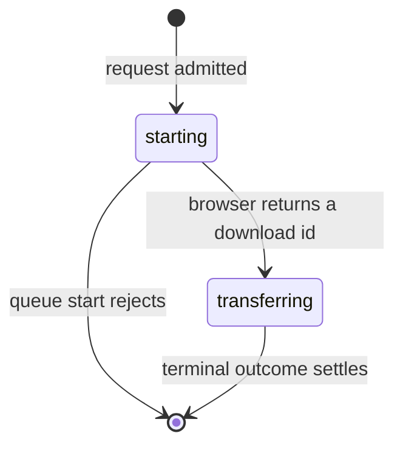

Storage: `inFlight` set (`background.ts:178`), `requestMetaById` map, `startingRequests` counter. All live in service worker memory.

| From | Event | To | Guard |
|---|---|---|---|
| absent | `DownloadRequest` admitted | starting | id not in `inFlight` |
| starting | `queue.enqueue` resolves with a download id | transferring | |
| starting | queue-start effects reject | absent | `Effect.onError` releases the id |
| transferring | terminal outcome settles | absent | |

`src/entrypoints/background.ts:1171`

```ts
const markRequestsInFlight = (
  requests: ReadonlyArray<PlannedDownload>,
  mediaById: ReadonlyMap<string, MediaItem>,
): void => {
  for (const r of requests) {
    inFlight.add(r.id)
    clearInterruptRetryState(r.id)
    const item = mediaById.get(r.id)
    requestMetaById.set(r.id, {
      url: r.url,
      filename: r.filename,
      ...(item ? { item } : {}),
    })
  }
```

Invariants:

1. An id in `inFlight` has a pending start or a tracked transfer.
2. `startingRequests` equals the number of requests inside `queue.enqueue`.
3. `requestMetaById` has an entry for every id in `inFlight`.

### 2.2 Transfer correlation (implicit)

**Business context.** Chrome reports download progress by its own numeric id. The extension knows the save by its request id. This machine links the two, so a "finished" or "failed" event from Chrome reaches the right save. It also catches an event that Chrome sent before the link existed.

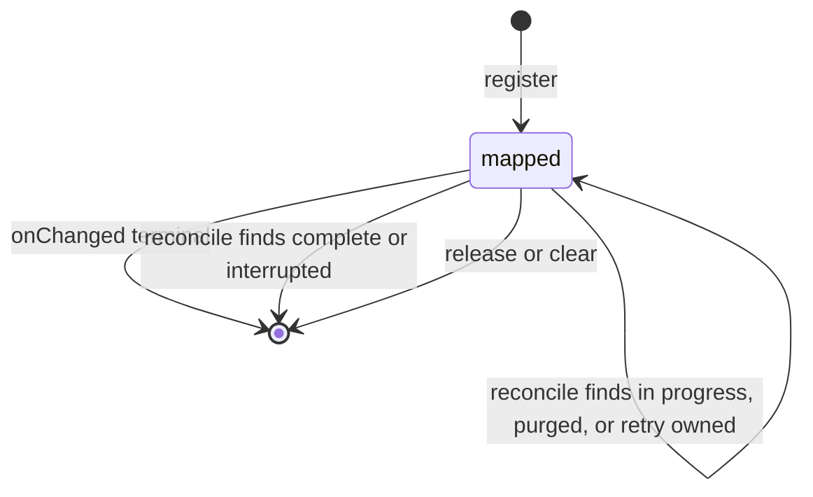

Storage: `downloadId → requestId` and `downloadId → startedAt` maps in `src/background/transfer-correlation.ts`.

| From | Event | To | Guard |
|---|---|---|---|
| unmapped | `register(downloadId, requestId, startedAt)` | mapped | |
| mapped | `downloads.onChanged` terminal | unmapped | mapping still names this request |
| mapped | `reconcile` finds `complete` or `interrupted` | unmapped | mapping unchanged after the search |
| mapped | `reconcile` finds in progress, purged, or retry owned | mapped | |
| mapped | `release` or `clear` | unmapped | |

`src/background/transfer-correlation.ts:95`

```ts
    reconcile: async ({ minAgeMs, only }) => {
      const now = ports.now()
      const wanted = only === undefined ? null : new Set(only)
      // Snapshot first: the settle ports release entries mid-loop.
      const due = [...requestByDownloadId.entries()].filter(
        ([downloadId, requestId]) =>
          (wanted === null || wanted.has(downloadId)) &&
          !ports.retryOwns(requestId) &&
          now - (startedAtByDownloadId.get(downloadId) ?? now) >= minAgeMs,
      )
      const stillDownloading = await Promise.all(
        due.map(([downloadId, requestId]) => reconcileOne(downloadId, requestId)),
      )
      return { inProgress: stillDownloading.filter(Boolean).length }
    },
```

Invariants:

1. Every mapped download id has a start time. The watchdog depends on it.
2. One download id settles one time. `settleBrowserDownload` (`background.ts:760`) and `reconcile` both re-check the mapping after each await.
3. A new batch never removes the mapping of a live transfer.

### 2.3 Transfer tracker and boot reconcile (implicit)

**Business context.** Chrome can stop the service worker in the middle of a download. When the worker starts again, it must find out what happened to each save it was tracking. This machine keeps the tracked list on disk and classifies each entry on boot.

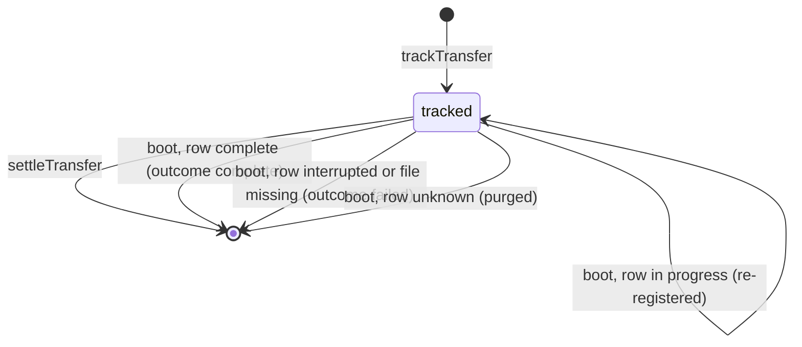

Storage: `TrackerState` (`transfer-tracker.ts:32`), persisted.

| From | Event | To | Guard |
|---|---|---|---|
| untracked | `trackTransfer` | tracked | |
| tracked | `settleTransfer` | untracked | |
| tracked | boot, row `complete` | untracked, outcome complete | file exists |
| tracked | boot, row `interrupted` or file missing | untracked, outcome failed | |
| tracked | boot, row in progress | tracked, re-registered in 2.2 | |
| tracked | boot, row unknown | untracked | purged by the browser |

`src/packages/download/transfer-tracker.ts:71`

```ts
export function classifyTransfer(row: ReconcileRow | undefined): ReconcileVerdict {
  if (row === undefined) return 'unknown'
  if (row.state === 'complete') return row.exists === false ? 'failed' : 'complete'
  if (row.state === 'interrupted') return 'failed'
  return 'in-progress'
}
```

Invariant: a boot-recovered outcome carries the same post id as a live outcome. `terminal-outcome.ts` reads `tweetId` from the tracked transfer when the caller has none.

### 2.4 Interrupt retry queue (implicit)

**Business context.** A network drop interrupts a download. The user must not have to click save again for a short outage. This machine retries an interrupted download up to 3 times with a growing delay, then reports it failed.

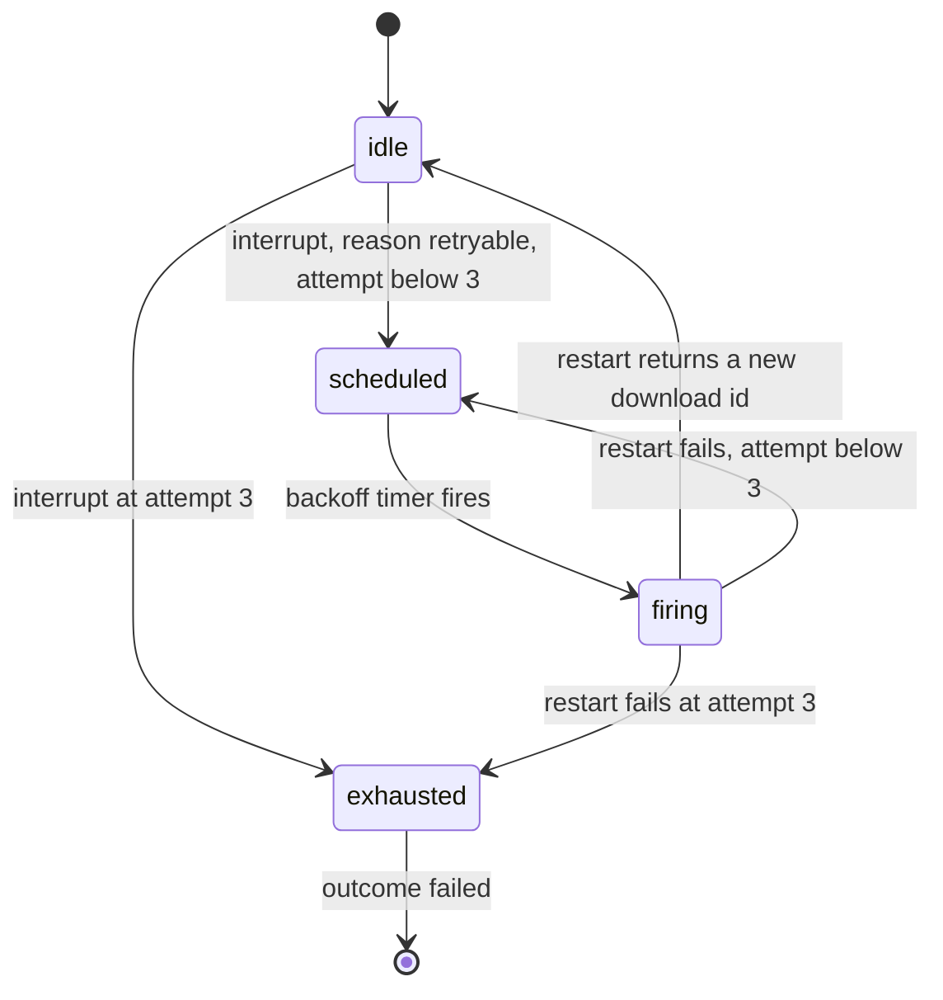

Owner: `makeRetryQueue` (`retry-queue.ts:100`). `INTERRUPT_RETRY_MAX` is 3.

`src/packages/download/interrupt-retry.ts:72`

```ts
export function planInterruptRetry(opts: {
  readonly reason: string | undefined
  readonly attempt: number
  readonly maxRetries?: number
}):
  | { readonly schedule: true; readonly delayMs: number; readonly nextAttempt: number }
  | { readonly schedule: false } {
  const maxRetries = opts.maxRetries ?? INTERRUPT_RETRY_MAX
  if (opts.attempt >= maxRetries) return { schedule: false }
  if (!isRetryableInterruptReason(opts.reason)) return { schedule: false }
  return {
    schedule: true,
    delayMs: interruptBackoffMs(opts.attempt),
    nextAttempt: opts.attempt + 1,
  }
}
```

Invariant: while the retry queue owns an id, no other path settles it. `reconcile` in 2.2 asks `retryOwns` first.

### 2.5 Stuck watchdog (implicit)

**Business context.** Chrome sometimes never sends the "finished" event, so a save would show as "saving" forever. This machine checks every 6 seconds for downloads older than 12 seconds and asks Chrome for their real state. It stops when nothing is saving, so the worker can sleep.

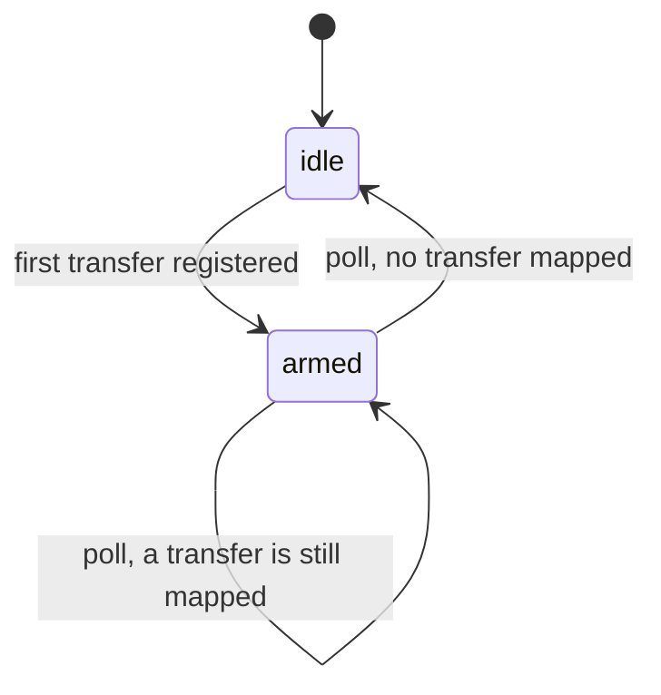

`src/entrypoints/background.ts:1079`

```ts
const STUCK_RECONCILE_AFTER_MS = 12_000
const STUCK_RECONCILE_POLL_MS = 6_000
let stuckPollTimer: ReturnType<typeof setInterval> | null = null

const stopStuckPollIfIdle = (): void => {
  if (stuckPollTimer !== null && transferCorrelation.size() === 0) {
    clearInterval(stuckPollTimer)
    stuckPollTimer = null
  }
}

const reconcileStuckDownloads = async (): Promise<void> => {
  await transferCorrelation.reconcile({ minAgeMs: STUCK_RECONCILE_AFTER_MS })
  stopStuckPollIfIdle()
}
```

Invariant: the watchdog is armed whenever a download id is mapped.

### 2.6 Metrics accumulator (implicit)

**Business context.** The popup shows "3 of 5 saved, 1 failed" for the current batch. This machine counts each save one time, even when Chrome reports the same result twice.

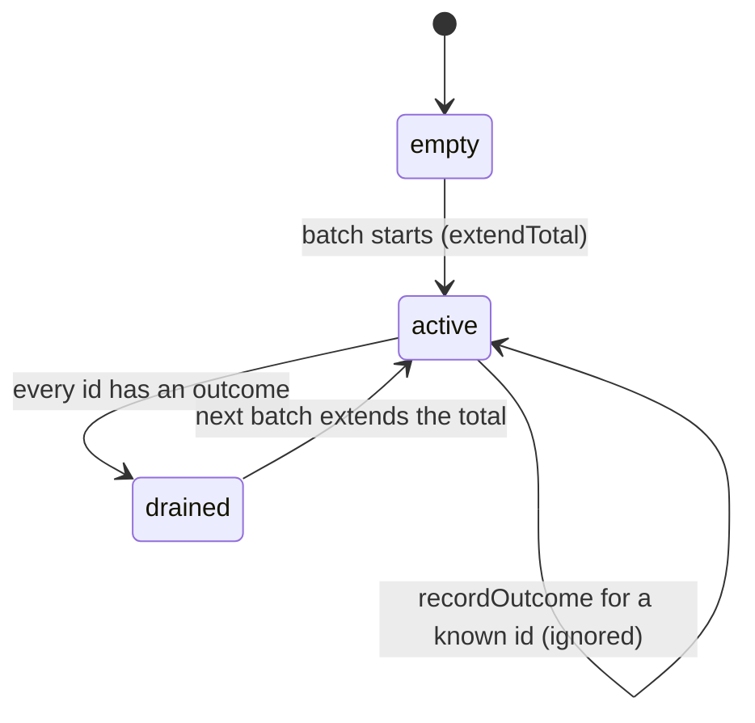

`src/packages/download/metrics.ts:125`

```ts
export function recordOutcome(
  state: MetricsState,
  id: string,
  outcome: ItemOutcome,
  _t: number,
): MetricsState {
  if (state.outcomes.has(id)) return state
  const outcomes = new Set(state.outcomes)
  outcomes.add(id)
  return {
    ...state,
    outcomes,
    completed: outcome === 'complete' ? state.completed + 1 : state.completed,
    failed: outcome === 'failed' ? state.failed + 1 : state.failed,
  }
}
```

Invariant: `completed + failed` never exceeds `total`.

### 2.7 Offscreen document (implicit)

**Business context.** Some media needs the user's login to download. The worker fetches the bytes, and a hidden page turns them into a file. Chrome allows one hidden page, so several saves share it. This machine counts the users and closes the page after the last one.

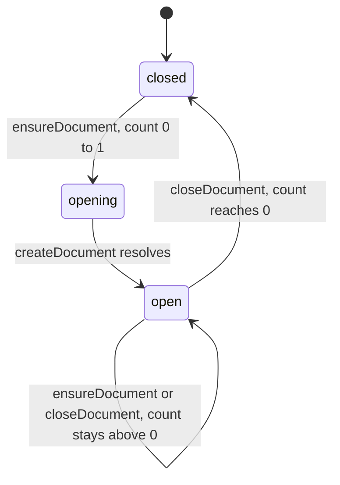

`src/packages/download/fetched-strategy.ts:252`

```ts
    ensureDocument: async () => {
      offscreenSaves += 1
      if (await browser.offscreen.hasDocument()) return
      if (offscreenOpening) return offscreenOpening
      offscreenOpening = browser.offscreen
        .createDocument({
          url: browser.runtime.getURL(OFFSCREEN_PATH),
          reasons: ['BLOBS'],
          justification: OFFSCREEN_JUSTIFICATION,
        })
        .finally(() => {
          offscreenOpening = null
        })
      return offscreenOpening
    },
```

`src/packages/download/fetched-strategy.ts:282`

```ts
    closeDocument: async () => {
      offscreenSaves = Math.max(0, offscreenSaves - 1)
      if (offscreenSaves > 0) return
      if (await browser.offscreen.hasDocument()) await browser.offscreen.closeDocument()
    },
```

Invariant: the page is open while the count is above zero. See O9 for the close race.

### 2.8 Daily budget (implicit)

**Business context.** The user can cap how much the extension downloads per day. This machine keeps one record per local calendar day and starts a fresh record at midnight.

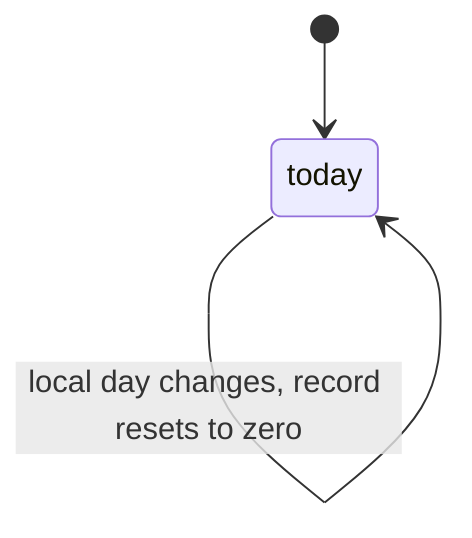

`src/packages/download/daily-budget.ts:16`

```ts
export function freshRecord(record: BudgetRecord | null, nowMs: number): BudgetRecord {
  const day = localDay(nowMs)
  if (record && record.day === day) return record
  return { day, bytes: 0, count: 0 }
}

/** freshRecord(record, now) then add the completion's bytes and count. */
export function addCompletion(
  record: BudgetRecord | null,
  nowMs: number,
  bytes: number,
  count: number,
): BudgetRecord {
  const base = freshRecord(record, nowMs)
  return { day: base.day, bytes: base.bytes + bytes, count: base.count + count }
}
```

Invariant: the record's `day` equals today whenever it is read. The budget counts completed work only. See O10.

### 2.9 History record (explicit)

**Business context.** The options page lists every save with its result. A row starts as "queued" and ends as "completed" or "failed". A Cloud-only save has one extra rule: a failed upload can still complete after a retry.

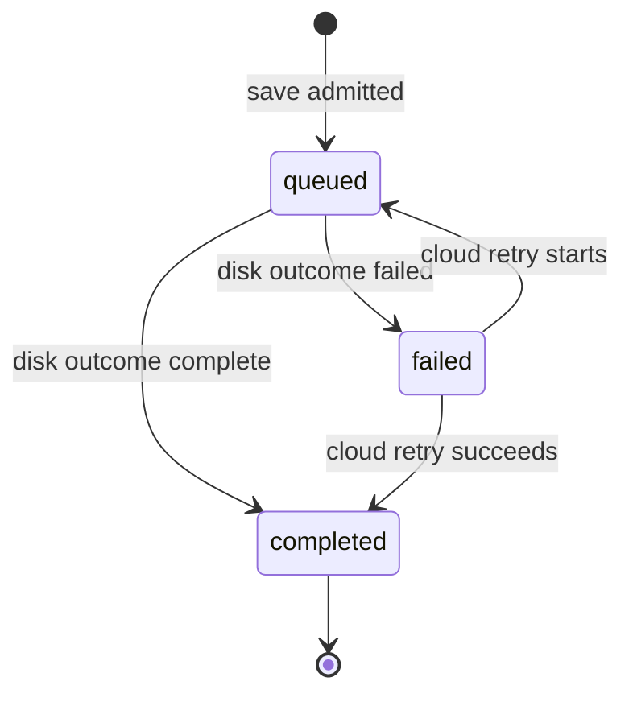

`DownloadStatus` (`history/record.ts:11`): `queued | completed | failed`.

`src/packages/history/store.ts:56`

```ts
export function applyTransition(
  store: DownloadStore,
  requestId: string,
  kind: 'completed' | 'failed',
  at: number,
  bytes?: { received: number; total: number },
): DownloadStore {
  let changed = false
  const records = store.records.map((r) => {
    if (r.requestId !== requestId || isTerminal(r.status)) return r
    changed = true
    return applyOutcome(r, kind, at, bytes)
  })
  return changed ? { records } : store
}
```

Invariant: `completed` is final. A disk outcome never changes a terminal row, which causes O13.

### 2.10 Start retry schedule

**Business context.** Starting a download can fail for a moment, for example when the CDN answers slowly. The queue retries the start a fixed number of times with a doubling delay before it reports a failure.

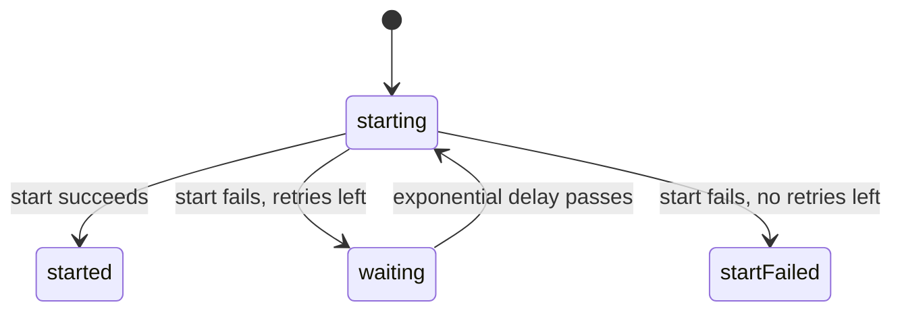

`src/packages/download/queue.ts:47`

```ts
  const retrySchedule = Schedule.exponential(`${retryBaseMs} millis`, 2).pipe(
    Schedule.upTo({ times: retries }),
  )
```

## 3. Cloud machines

Owner files: `src/packages/cloud/`, `src/background/cloud-upload.ts`, `src/background/remote-upload.ts`, `src/background/sync-outbox.ts`, `src/background/capture-*.ts`.

### 3.1 Upload job (explicit)

**Business context.** The user wants each saved file copied to Google Drive or Dropbox. One job exists per media and provider. Chrome can stop the worker in the middle of an upload, so each attempt holds a timed lease. A lease that expires means the attempt crashed, and the job can be tried again, up to 5 times.

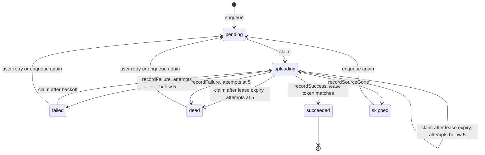

`JobStatus` (`upload-job.ts:41`): `pending | uploading | succeeded | failed | dead | skipped`. Terminal set: `succeeded`, `dead`, `skipped`. `MAX_ATTEMPTS` is 5. `LEASE_MS` is 300 000.

| From | Event | To | Guard |
|---|---|---|---|
| absent | `enqueue` | pending | |
| failed, dead, skipped | `enqueue` again | pending | takes `cloudOnly` from the new request |
| succeeded, uploading | `enqueue` again | unchanged | `upload-job.ts:184` |
| pending, failed | `claim` | uploading | `nextAttemptAt` reached, lease token issued |
| uploading | `claim` after lease expiry | uploading | attempts below 5 |
| uploading | `claim` after lease expiry | dead | attempts at 5 |
| uploading | `recordSuccess` | succeeded | lease token matches |
| uploading | `recordFailure` | failed or dead | lease token matches |
| uploading | `recordSourceGone` | skipped | lease token matches |
| failed, dead | `retry` (user) | pending | `upload-job.ts:395` |

`src/packages/cloud/upload-job.ts:274`

```ts
  const attempts = job.status === 'uploading' ? job.attempts + 1 : job.attempts
  if (job.status === 'uploading' && attempts >= MAX_ATTEMPTS) {
    const dead: UploadJob = {
      ...job,
      status: 'dead',
      attempts,
      leaseUntil: null,
      error: 'crashed: attempts exhausted',
    }
    return { ledger: replaceJob(ledger, dead), claimed: false, reason: 'exhausted' }
  }
  const leaseSeq = job.leaseSeq + 1
  const started: UploadJob = {
    ...job,
    status: 'uploading',
    attempts,
    leaseSeq,
    leaseUntil: now + lease,
    nextAttemptAt: now + lease,
    error: null,
  }
  return { ledger: replaceJob(ledger, started), claimed: true, token: leaseSeq }
```

`src/packages/cloud/upload-job.ts:298`

```ts
const onHeldLease = (
  ledger: JobLedger,
  jobId: string,
  token: number,
  fn: (job: UploadJob) => UploadJob,
): TransitionResult => {
  const job = ledger.find((j) => j.jobId === jobId)
  if (job === undefined || job.status !== 'uploading' || job.leaseSeq !== token) {
    return { ledger, changed: false }
  }
  return { ledger: replaceJob(ledger, fn(job)), changed: true }
}
```

Invariants:

1. Only the holder of the current lease token can write an outcome.
2. Every move to a terminal state reaches the mirror and, for a Cloud-only job, the history verdict. `publishMovedJob` (`cloud-upload.ts:561`) covers moves that happen without an upload attempt.
3. `cloudOnly` describes the latest request for the media.

### 3.2 Upload drain and wake alarm (implicit)

**Business context.** A failed upload waits before its next try. The worker may be asleep when that wait ends. This machine sets a Chrome alarm for the earliest retry time, so the upload resumes without the user opening the extension.

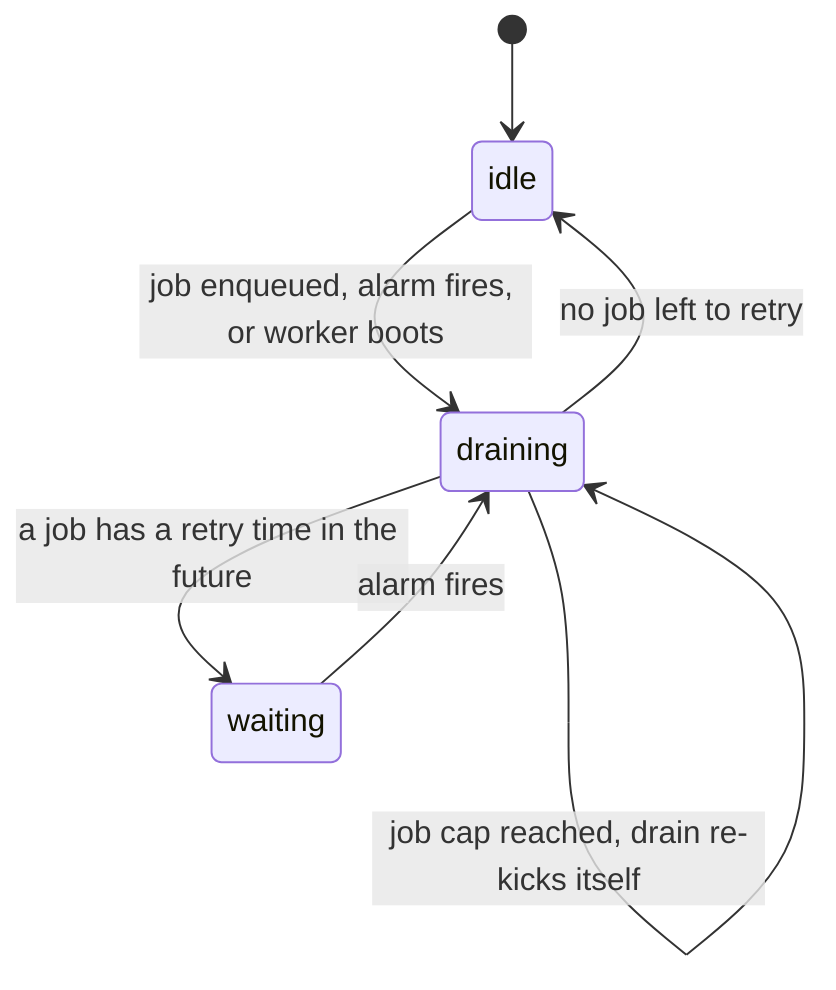

`src/background/cloud-upload.ts:570`

```ts
  const scheduleUploadWake = async (): Promise<void> => {
    const ledger = await readLedger()
    const now = nowFn()
    const due = ledger
      .filter((j) => !isTerminal(j) && j.attempts < MAX_ATTEMPTS)
      .map((j) => j.nextAttemptAt)
      .filter((t) => t > now)
    if (due.length > 0) await alarms.create(UPLOAD_ALARM, Math.min(...due))
    else await alarms.clear(UPLOAD_ALARM)
  }
```

Invariant: an alarm exists whenever a non-terminal job waits for a future retry time. See O25.

### 3.3 OAuth token (implicit)

**Business context.** The user connects Drive or Dropbox one time. The access token lasts about an hour, so the extension renews it in the background. The user must never see an upload fail only because the token aged out.

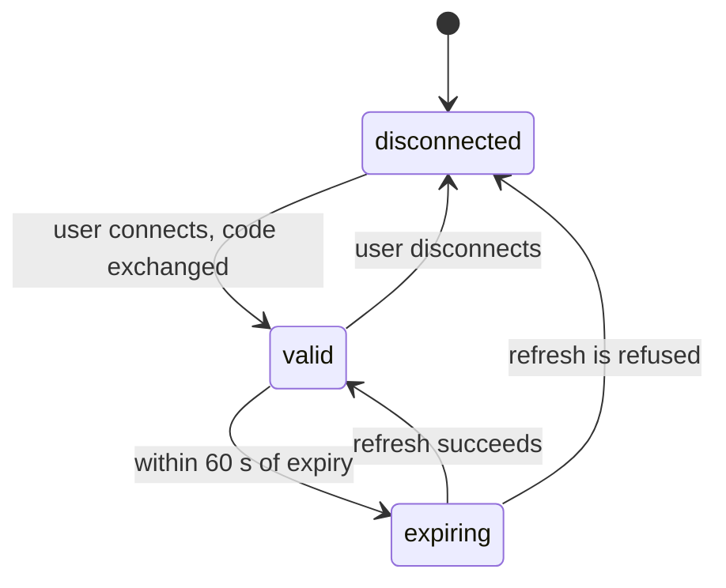

`src/packages/cloud/oauth.ts:267`

```ts
/** Whether a token expires within `skewMs` of `now` (refresh proactively). */
export const isTokenExpired = (expiresAt: number, now: number, skewMs = 60_000): boolean =>
  now >= expiresAt - skewMs
```

Invariant: an upload starts only with a token that is valid for at least 60 more seconds. See O24.

### 3.4 Drive folder cache (implicit)

**Business context.** Files go into folders on Drive, for example one per platform. Looking up a folder costs a Drive request. This cache remembers each folder id for the life of the worker, so a batch of files asks one time.

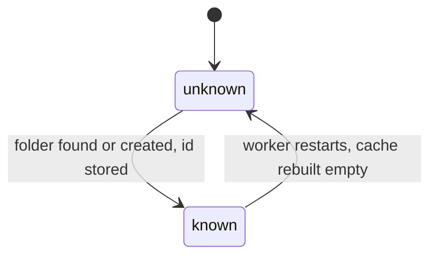

`src/packages/cloud/lib/folder-cache.ts:16`

```ts
export const FolderCacheLive = Layer.effect(
  FolderCache,
  Effect.gen(function* () {
    const ref = yield* Ref.make<Record<string, string>>({})
    return {
      get: (k) => Ref.get(ref).pipe(Effect.map((r) => Option.fromUndefinedOr(r[k]))),
      set: (k, id) => Ref.update(ref, (r) => ({ ...r, [k]: id })),
    }
  }),
)
```

Invariant: a cached id belongs to the connected Drive account. Reconnect breaks this. See O26.

### 3.5 Relay receipt (implicit)

**Business context.** In the experimental relay mode, the user's own Convex server uploads to Drive, so the browser sends no Drive bytes. Dropbox still uploads from the browser. The extension keeps a receipt per media to remember that the server accepted the job, and to copy the server's result into history.

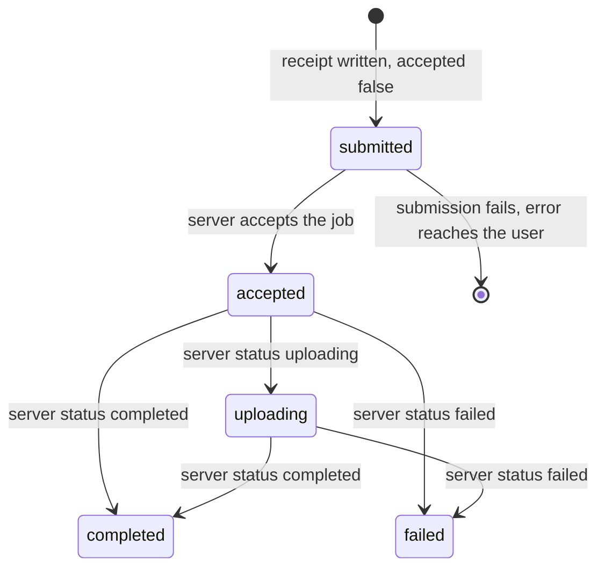

`src/background/remote-upload.ts:13`

```ts
const Receipt = Schema.Struct({
  mediaId: Schema.String,
  deviceId: Schema.String,
  deploymentUrl: Schema.String,
  syncSecret: Schema.optional(Schema.String),
  budgetDay: Schema.optional(Schema.String),
  sourceUrl: Schema.String,
  path: Schema.String,
  contentType: Schema.String,
  accepted: Schema.Boolean,
  estimatedBytes: Schema.optional(Schema.Number),
  historyOutcome: Schema.optional(Schema.Literals(['queued', 'completed', 'failed'])),
})
```

Invariants:

1. Media with an accepted receipt never enters the browser Drive queue.
2. A failed submission is reported. It never becomes a browser upload or a disk save (ADR-0013).

### 3.6 Cloud-only history verdict (derived)

**Business context.** In Cloud-only mode nothing is saved to disk, so the history row waits for the cloud. With two providers enabled, the row is "completed" only when both succeeded, and "failed" only when both gave up.

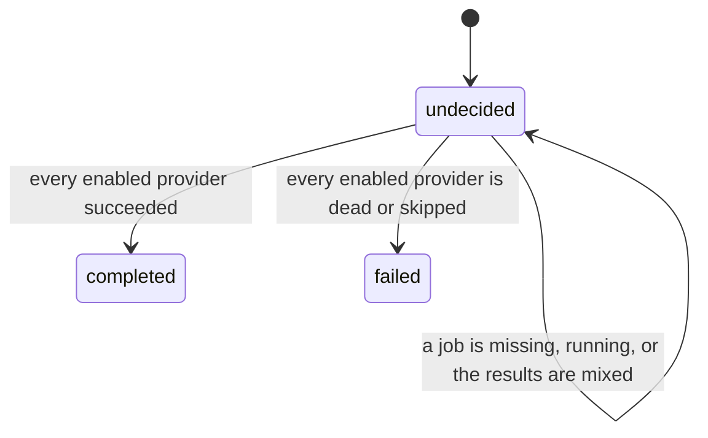

`src/packages/cloud/upload-job.ts:118`

```ts
export function cloudHistoryVerdict(
  ledger: JobLedger,
  mediaId: string,
  enabledProviders: ReadonlyArray<CloudProviderId>,
): 'completed' | 'failed' | null {
  if (enabledProviders.length === 0) return null
  const jobs = enabledProviders
    .map((provider) => ledger.find((job) => job.mediaId === mediaId && job.provider === provider))
    .filter((job): job is UploadJob => job !== undefined)
  if (jobs.length !== enabledProviders.length) return null
  const statuses = jobs.map((job) => job.status)
  if (statuses.every((status) => status === 'succeeded')) return 'completed'
  if (statuses.every((status) => status === 'dead' || status === 'skipped')) return 'failed'
  return null
}
```

Invariant: the verdict is sent one time per media.

### 3.7 Sync outbox (implicit)

**Business context.** With Cloud Sync on, the extension tells the user's Convex deployment about each save, so another device knows the media is already saved. Events queue on disk and go out in order. An alarm retries them after an outage.

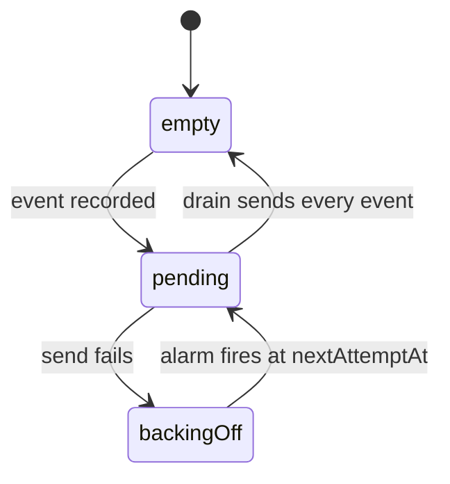

`src/background/sync-outbox.ts:153`

```ts
  const scheduleSyncWake = async (state?: ReturnType<typeof decodeOutbox>): Promise<void> => {
    const current = state ?? (await readOutbox())
    const at = now()
    if (current.pending.length > 0 && current.nextAttemptAt > at)
      await alarms.create(SYNC_ALARM, current.nextAttemptAt)
    else await alarms.clear(SYNC_ALARM)
  }
```

Invariant: events leave in the order they were recorded. A permanently rejected event blocks the rest. See O30.

### 3.8 Capture outbox (implicit)

**Business context.** The archive feature stores the text of posts the user saw. The user can opt in to mirror that text to their Convex deployment. "Clear capture" is a privacy action, so it must also drop text that still waits to be sent.

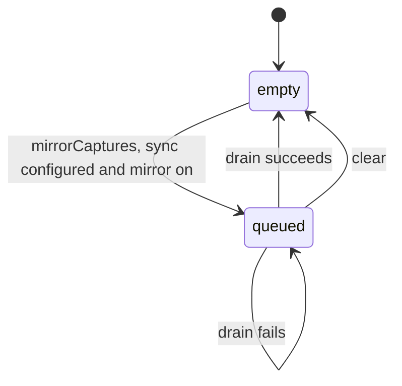

Ledger `local:captureOutbox`.

`src/background/capture-outbox.ts` (`clear`)

```ts
    clear: () =>
      queue.run(async () => {
        await runSerializedRmw(storeQueue, ledger, decodeLedger, () => [])
      }),
```

Invariant: after "Clear capture", no erased post leaves the device.

### 3.9 Capture store (implicit)

**Business context.** The same post is seen many times, sometimes with full detail and sometimes as a thin timeline row. The archive must keep the richest version it ever saw.

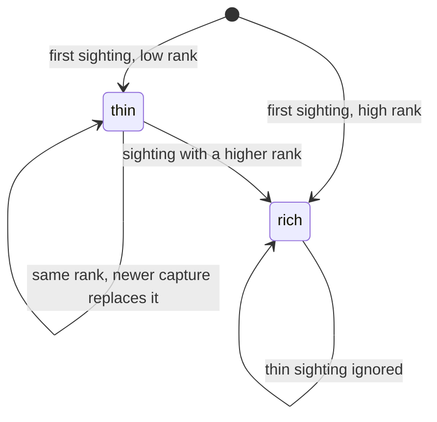

`src/packages/capture/store.ts:25`

```ts
export function mergeRecord(existing: TweetRecord | undefined, incoming: TweetRecord): TweetRecord {
  if (existing === undefined) return incoming
  if (incoming.sourceRank > existing.sourceRank) return incoming
  if (incoming.sourceRank === existing.sourceRank && incoming.capturedAt >= existing.capturedAt) {
    return incoming
  }
  return existing
}
```

`src/background/capture-db.ts` (`putRecords`)

```ts
        if (records.length === 0) return
        const byTweet = new Map<string, TweetRecord>()
        for (const record of records) {
          byTweet.set(record.tweetId, mergeRecord(byTweet.get(record.tweetId), record))
        }
        await store.upsert([...byTweet.values()], mergeRecord)
```

Invariant: a thin sighting never replaces a rich one, inside one batch or across batches.

### 3.10 Saved index (implicit)

**Business context.** The overlay marks posts the user already saved, including saves from another device. The index answers at once from what it knows locally, then asks Convex in the background and pushes late hits to the page.

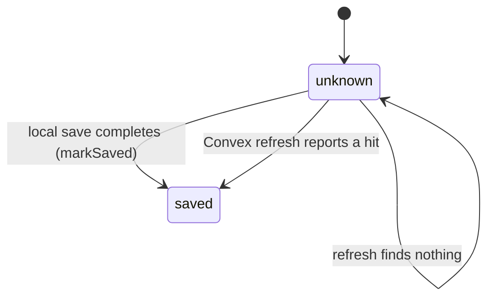

`src/background/saved-status.ts:32`

```ts
    handle: async (req) => {
      const ids = [...req.tweetIds]
      // Fire the backstop behind the reply. `refresh` never rejects and
      // coalesces concurrent sweeps, so a scroll burst costs one query.
      void (async () => {
        const fresh = await deps.index.refresh(ids, deps.queryConvex)
        if (fresh.length > 0) deps.notifyFresh?.(fresh)
      })()
      return { _tag: 'SavedStatusResponse', saved: deps.index.known(ids) }
    },
    onCompleted: (tweetId) => deps.index.markSaved(tweetId),
```

Invariant: `saved` never goes back to `unknown` during a session.

## 4. Clear machines

Owner files: `src/packages/clear/`, `src/background/clear-session.ts`, `src/background/tab-broadcaster.ts`.

"Clear" means: after the media of a bookmarked or liked post is saved, the extension removes the bookmark or like. This works the bookmark list down to empty. It is destructive on the user's X account, so every machine here fails closed.

### 4.1 Completion ledger (explicit)

**Business context.** A post can have four photos. The bookmark may be removed only when all four are safely on disk. The ledger tracks each media id of a post and, per list (bookmark, like, not interested), whether the removal was done.

Media side, one per media id:

```mermaid
stateDiagram-v2
    [*] --> inProgress: seed or Extend
    inProgress --> doneUnsettled: Complete
    doneUnsettled --> doneSettled: Settle
    inProgress --> failed: Fail
    doneUnsettled --> failed: LateInterrupt
    failed --> inProgress: Extend, same media saved again
    doneSettled --> inProgress: Extend, same media saved again
```

Scope side, one per list:

```mermaid
stateDiagram-v2
    [*] --> none
    none --> clearing: ClaimClear, post truly complete
    failed --> clearing: ClaimClear, retry
    clearing --> cleared: ResolveClear ok
    clearing --> failed: ResolveClear not ok
    cleared --> [*]
```

`src/packages/clear/ledger.ts:150`

```ts
export const isTrulyComplete = (e: LedgerEntry): boolean =>
  isStrategyEligible(e) &&
  e.expected.size > 0 &&
  e.failed.size === 0 &&
  e.inProgress.size === 0 && // left the in-progress set — not just first 'complete'
  [...e.expected].every((id) => e.done.has(id))

/** A scope can be claimed when the tweet is truly complete, in that scope, and not
 *  already cleared or mid-clear. `failed` IS re-claimable (retry); `cleared`/`clearing` are not. */
export const canClaim = (e: LedgerEntry, scope: Scope): boolean =>
  isTrulyComplete(e) &&
  e.scopes.has(scope) &&
  (e.clear[scope] === 'none' || e.clear[scope] === 'failed')
```

`src/packages/clear/ledger.ts:134`

```ts
    case 'ClaimClear':
      if (!canClaim(e, a.scope)) return e
      return { ...e, clear: { ...e.clear, [a.scope]: 'clearing' } }

    case 'ResolveClear':
      if (e.clear[a.scope] !== 'clearing') return e
      return { ...e, clear: { ...e.clear, [a.scope]: a.ok ? 'cleared' : 'failed' } }
```

Invariants:

1. A post is released only when every media item the user asked for is saved. `planClearSeed` (`seed.ts`) drops a post when admission withheld part of it. It widens the expected set when another request already has part of it in flight.
2. A scope has at most one claim. `clearing` cannot be claimed again.
3. `Extend` never shrinks the expected set.
4. The ledger lives in memory only. A worker restart drops unresolved entries. See section 8.

### 4.2 Clear attempt (implicit)

**Business context.** A removal waits in a queue behind other removals, sometimes for many seconds. The user can turn "clear on save" off during that wait. The switch must stop every removal that has not clicked yet.

```mermaid
stateDiagram-v2
    [*] --> claimed: scopes claimed in the ledger
    claimed --> dispatching: sent to the tab broadcaster
    dispatching --> released: still authorized, tab confirms
    dispatching --> revoked: clear off, scope off, reset, or entry gone
    dispatching --> failedAttempt: tab reports failure
    released --> [*]
    revoked --> [*]
    failedAttempt --> [*]
```

`src/background/clear-session.ts:338`

```ts
  const releaseStillAuthorized = async (tweetId: string): Promise<boolean> => {
    const attempt = dispatching.get(tweetId)
    const revoked = (reason: string): false => {
      trace('clear-release-revoked', { tweetId, detail: `reason=${reason}` })
      return false
    }
    if (attempt === undefined) return revoked('no-dispatch')
    if (attempt.generation !== generation) return revoked('reset')
    const settings = await getSettings()
    if (!settings.clearOnSave) return revoked('clear-off')
    const entry = clearLedger.get(tweetId)
    if (entry === undefined) return revoked('no-entry')
    const enabled = enabledScopesFor(entry, settings)
    return attempt.claimed.every((scope) => enabled.has(scope)) || revoked('scope-off')
  }
```

Invariant: turning "clear on save" off, turning a scope off, or resetting the session stops every release that has not started.

### 4.3 Origin record (implicit)

**Business context.** The removal must happen on the list the user saved from. A post saved from the bookmarks page must not empty a different list. This map remembers the tab and list of the latest save of each post.

```mermaid
stateDiagram-v2
    [*] --> remembered: seed with an origin
    remembered --> remembered: newer seed for the same post replaces it
    remembered --> [*]: evicted, more than 512 posts remembered
```

`src/background/clear-session.ts:210`

```ts
  const rememberOrigin = (tweetId: string, origin: ClearOrigin): void => {
    clearOriginTab.delete(tweetId)
    clearOriginTab.set(tweetId, origin)
    for (const oldest of clearOriginTab.keys()) {
      if (clearOriginTab.size <= CLEAR_ORIGIN_TAB_CAP) break
      clearOriginTab.delete(oldest)
    }
  }
```

Invariant: the latest seed wins. A seed that can pin no list makes the release fail closed. See O19.

### 4.4 Sweep worklist (explicit)

**Business context.** "Save and clear my whole bookmark list" is a long job. The user can close the popup, and Chrome can stop the worker. This list is stored on disk, so the job resumes and never touches a post it already cleared.

```mermaid
stateDiagram-v2
    [*] --> queued: enqueue
    queued --> downloaded: media saved
    queued --> failed: save or clear failed
    downloaded --> failed: clear failed
    queued --> cleared: clear confirmed
    downloaded --> cleared: clear confirmed
    failed --> cleared: retry confirmed
    cleared --> [*]
```

`SweepState` (`worklist.ts:22`): `queued | downloaded | cleared | failed`.

`src/packages/clear/worklist.ts:93`

```ts
export const markState = (
  wl: SweepWorklist,
  tweetId: string,
  scope: ClearScope,
  state: SweepState,
  at: number,
): SweepWorklist => {
  const key = keyFor(scope, tweetId)
  const existing = wl[key]
  if (existing === undefined || existing.state === 'cleared' || existing.state === state) return wl
  return { ...wl, [key]: { ...existing, state, at } }
}
```

Invariant: `cleared` is final. See O16 and O18.

### 4.5 Tab dispatch (implicit)

**Business context.** Only a page on x.com can click "remove bookmark". The worker first asks the open X tabs that show the post. When none can do it, it opens the post in a hidden tab and clicks there. Each path can fail, and a failure must never be reported as a success.

```mermaid
stateDiagram-v2
    [*] --> fanOut: dispatch
    fanOut --> done: a mounted tab clears the post
    fanOut --> releaseQueued: no tab could, release tab allowed
    fanOut --> noopOnly: a tab had the post, every scope was a no-op
    fanOut --> exhausted: no usable tab answered
    releaseQueued --> revoked: authorization withdrawn
    releaseQueued --> done: release tab clears the post
    releaseQueued --> releaseFailed: release tab fails
```

`src/background/tab-broadcaster.ts:1002`

```ts
      // The leg may have waited behind other legs since its scopes were claimed.
      // Ask again here, inside the queue, right before it navigates and clicks.
      const released = await releaseQueue.run(async () =>
        deps.releaseAuthorized === undefined || (await deps.releaseAuthorized(tweetId))
          ? releaseViaStatusTab(tweetId, scopes, allLists, plan.asPageScope)
          : ('revoked' as const),
      )
      if (released === 'revoked') {
        traceDispatch('release-revoked', true)
        return scopes.map((scope) => ({ scope, ok: false }))
      }
```

Invariant: every path except `done` returns `ok: false` for each scope. See O15 and O20.

### 4.6 Mutation witness (implicit)

**Business context.** After the page clicks "remove bookmark", the button can look changed while X's server refused the request. The witness records X's own network reply for each post and action. The server's answer outranks what the page shows.

```mermaid
stateDiagram-v2
    [*] --> none
    none --> ok: reply recorded, status 200, no error
    none --> error: reply recorded with a failure
    ok --> none: evicted, or older than the click
    error --> none: evicted, or older than the click
```

`src/packages/clear/mutation-witness.ts:91`

```ts
  function outcome(
    tweetId: string,
    scope: MembershipScope,
    sinceT: number,
  ): 'ok' | 'error' | 'none' {
    const ev = events.get(`${tweetId}:${CONFIRMING_OP[scope]}`)
    if (ev === undefined || ev.startedAt < sinceT) return 'none'
    return ev.status === 200 && !ev.error ? 'ok' : 'error'
  }
```

Invariant: only a reply whose request started at or after the click counts.

### 4.7 Release recheck watchdog (implicit)

**Business context.** X sometimes reverts a removal a few seconds later. This watchdog looks at the post again, 6 times at 5 second intervals, and logs loudly when the bookmark came back. It only observes. It never clicks.

```mermaid
stateDiagram-v2
    [*] --> scheduled: release reported ok
    scheduled --> scheduled: probe absent or unknown, attempts left
    scheduled --> reverted: probe finds the post is a member again
    scheduled --> finished: 6 attempts used
    scheduled --> [*]: cancelled
```

`src/packages/clear/recheck.ts:137`

```ts
export function makeReleaseRecheck(deps: ReleaseRecheckDeps) {
  const interval = deps.intervalMs ?? RELEASE_RECHECK_INTERVAL_MS
  const attempts = deps.attempts ?? RELEASE_RECHECK_ATTEMPTS
  // One pending probe chain per (tweetId, scope) — the same post can be released from
  // bookmarks and likes independently, and each is its own question.
  const pending = new Map<string, () => void>()
```

Invariant: one probe chain exists per post and scope.

### 4.8 Popup confirm strip (implicit)

**Business context.** Destructive buttons such as "Erase archive" need two clicks. The first click arms the button and shows the consequence. The second click commits. An armed button disarms by itself after a deadline, and only one button can be armed at a time.

```mermaid
stateDiagram-v2
    [*] --> idle
    idle --> armed: first click
    armed --> idle: deadline passes
    armed --> idle: another strip is armed
    armed --> idle: user cancels
    armed --> committed: second click
    committed --> idle
```

`src/components/confirm-strip.tsx:345`

```tsx
    if (armedAt === null) return undefined
```

`src/components/confirm-strip.tsx:351`

```tsx
    if (armedAt === null) return
    if (now >= disarmDeadline(armedAt)) disarm()
```

Invariant: at most one strip is armed on a surface (`disarmCurrent`, `confirm-strip.tsx:21`).

## 5. Overlay and UI machines

Owner files: `src/entrypoints/overlay.content/`, `src/packages/overlay/`, `src/core/`.

### 5.1 Quick Grab (explicit)

**Business context.** The user holds a modifier key and moves the pointer over media to save it without clicking. A half second dwell prevents a save from a pointer that only passes by. Each item is saved one time per key press.

Mode, one per key press:

```mermaid
stateDiagram-v2
    [*] --> inactive
    inactive --> active: modifier pressed
    active --> active: item grabbed, key remembered
    active --> inactive: modifier released, grabbed set forgotten
```

Hover label, one per hovered item (`QuickGrabUiPhase`, `quickgrab.ts:17`):

```mermaid
stateDiagram-v2
    [*] --> charging: hover an item not grabbed this press
    [*] --> noted: hover an item already grabbed
    charging --> queued: 500 ms dwell ends, save sent
    charging --> [*]: pointer leaves or modifier released
    noted --> [*]: pointer leaves or modifier released
    queued --> saved: start acknowledged
    queued --> failed: start refused
    saved --> [*]
    failed --> [*]
```

`src/packages/overlay/quickgrab.ts:105`

```ts
export function pressModifier(state: QuickGrabState): QuickGrabState {
  return state.active ? state : { active: true, grabbed: state.grabbed }
}

/** Leave grab mode and forget what was grabbed this press. */
export function releaseModifier(): QuickGrabState {
  return idleQuickGrab
}

/** Whether hovering `key` should fire a grab now: active and not yet grabbed. */
export function canGrab(state: QuickGrabState, key: string): boolean {
  return state.active && !state.grabbed.has(key)
}
```

`src/entrypoints/overlay.content/index.tsx:1249`

```tsx
    const armHover = (media: HoverMediaElement, key: string): void => {
      if (canGrab(grab, key)) {
        grabUi = { key, rect: rectOf(media), phase: 'charging', all: postGrabArmed }
        rerender()
        hoverArmedAt = Date.now()
        traceQuickGrab('armed', { key })
        dwell = setTimeout(() => fireGrab(media, key), quickGrabDwellMs)
      } else {
        grabUi = { key, rect: rectOf(media), phase: 'noted', all: postGrabArmed }
        rerender()
      }
    }
```

Invariant: one item fires at most one save per key press. See O6.

### 5.2 Badge (explicit)

**Business context.** A small download button appears on a photo when the pointer rests on it. It hints after 2.2 seconds, shows "saving", then "saved" or "retry". An early "saved" only means the browser took the job, so a late failure corrects it.

```mermaid
stateDiagram-v2
    [*] --> hidden
    hidden --> shown: pointer enters media
    shown --> nudged: 2.2 s without a click
    shown --> queued: click
    nudged --> queued: click
    failed --> queued: click to retry
    queued --> saved: start acknowledged
    queued --> failed: start refused
    saved --> failed: late outcome failed
    saved --> shown: 1.6 s revert
    shown --> hidden: pointer leaves
    nudged --> hidden: pointer leaves
    queued --> hidden: pointer leaves
    saved --> hidden: pointer leaves
    failed --> hidden: pointer leaves
```

`BadgePhase` (`badge.ts:2`): `hidden | shown | nudged | queued | saved | failed`.

`src/packages/overlay/badge.ts:90`

```ts
export function nudgeBadge(state: BadgeState): BadgeState {
  return state.phase === 'shown' ? { phase: 'nudged', key: state.key } : state
}
```

`src/packages/overlay/badge.ts:102`

```ts
export function resolveSave(state: BadgeState, ok: boolean): BadgeState {
  return state.phase === 'queued' ? { phase: ok ? 'saved' : 'failed', key: state.key } : state
}
```

Invariant: a reply changes the badge only while it is `queued` or `saved` for the same media key.

### 5.3 Launcher (explicit)

**Business context.** A floating pill offers "Download all" for every media item found on the page. One batch runs at a time. One failed item turns the whole pill to "retry".

```mermaid
stateDiagram-v2
    [*] --> idle
    idle --> queued: click
    failed --> queued: click to retry
    queued --> saved: start acknowledged
    queued --> failed: start refused or an item fails
    saved --> failed: a late item fails
    saved --> idle: 1.6 s revert
    failed --> idle: 4 s revert
```

`src/packages/overlay/launcher.ts:13`

```ts
export function beginSendAll(phase: LauncherPhase): LauncherPhase {
  return phase === 'idle' || phase === 'failed' ? 'queued' : phase
}
```

`src/packages/overlay/launcher.ts:36`

```ts
export function resolveSendAll(phase: LauncherPhase, ok: boolean): LauncherPhase {
  return phase === 'queued' ? (ok ? 'saved' : 'failed') : phase
}

/** Expire a settled confirmation back to idle; idle and in-flight stay put. */
export function settleLauncher(phase: LauncherPhase): LauncherPhase {
  return phase === 'saved' || phase === 'failed' ? 'idle' : phase
}
```

Invariant: a click while `queued` or `saved` does nothing.

### 5.4 Video-recovery claim (implicit)

**Business context.** X sometimes shows a video without a downloadable address in the page data. The overlay asks the worker to look the address up, one time per post. X is a single-page app, so the user can move to another page before the answer returns. The answer must not be attached to the new page.

```mermaid
stateDiagram-v2
    [*] --> unclaimed
    unclaimed --> claimed: markAttempted, lookup sent
    claimed --> unclaimed: lookup retryable (unmarkAttempted)
    claimed --> unclaimed: navigation clears the store
    claimed --> resolved: reply applied while the claim is held
```

`src/core/adapters/detection-store.ts:312`

```ts
    markAttempted: (tweetId) => {
      if (attempted.has(tweetId)) return false
      attempted.add(tweetId)
      return true
    },
    unmarkAttempted: (tweetId) => {
      attempted.delete(tweetId)
    },
    holdsRecoveryClaim: (tweetId) => attempted.has(tweetId),
```

`src/entrypoints/overlay.content/index.tsx:861`

```tsx
          // A navigation since the send cleared the store and this claim with it.
          // The reply describes the previous page, so it must not enter this one.
          if (!store.holdsRecoveryClaim(tweetId)) return
```

Invariant: a recovery reply is applied only while its claim is held.

### 5.5 Saved-status sweep (implicit)

**Business context.** As the user scrolls, new posts appear and need their "already saved" mark. The overlay asks the worker in batches. A burst of scrolling must cost one request, and a request that is running must not be started twice.

```mermaid
stateDiagram-v2
    [*] --> waiting
    waiting --> scheduled: page changes, tab active
    scheduled --> running: delay passes
    running --> running: page changes, rerun remembered
    running --> scheduled: sweep ends, rerun was remembered
    running --> waiting: sweep ends, nothing new
    scheduled --> waiting: stop
    waiting --> disposed: teardown
```

`src/entrypoints/overlay.content/saved-status-lifecycle.ts:55`

```ts
  const schedule = (): void => {
    if (disposed || !deps.isActive()) return
    if (running) {
      rerun = true
      return
    }
    cancelPending()
    cancelTimer = deps.clock.after(deps.delayMs, () => {
      cancelTimer = null
      void run().catch(() => {})
    })
  }
```

Invariant: at most one sweep runs at a time.

### 5.6 Save destination coupling (implicit)

**Business context.** A save must always have somewhere to go. The user can turn "Save to this computer" off only when a cloud destination is live. When the last cloud destination goes away, the extension turns disk saving back on.

```mermaid
stateDiagram-v2
    [*] --> diskOnly
    diskOnly --> diskAndCloud: cloud destination connected
    diskAndCloud --> cloudOnly: user turns disk saving off
    cloudOnly --> diskAndCloud: user turns disk saving on
    cloudOnly --> diskOnly: last cloud destination lost, disk forced on
    diskAndCloud --> diskOnly: cloud destination lost
```

`src/packages/settings/coupling.ts:35`

```ts
export function saveToDiskToggleDelta(enabled: boolean, settings: Settings): Partial<Settings> {
  if (enabled) return { saveToDisk: true }
  if (settings.convexDriveEnabled || hasLiveCloudDestination(settings)) return { saveToDisk: false }
  return { saveToDisk: true }
}

/** Settings delta after Cloud upload, Connect, or a per-provider pause changes.
 *  Cloud-only without a live destination is forced back to local save. */
export function destinationLostDelta(settings: Settings): Partial<Settings> {
  if (settings.convexDriveEnabled || settings.saveToDisk || hasLiveCloudDestination(settings))
    return {}
  return { saveToDisk: true }
}
```

Invariant: `saveToDisk` is false only when a destination exists. `convexDriveEnabled` alone satisfies the check, which is O4. See also O2 and O3.

### 5.7 Extension context (implicit)

**Business context.** When the extension updates, pages that are already open keep the old overlay, which can no longer reach the worker. The overlay must tell the user to reload the page. It must not report every save as failed.

```mermaid
stateDiagram-v2
    [*] --> live
    live --> live: message fails with a real error, shown as a failure
    live --> dead: message fails with a dead-context error
    dead --> [*]: user reloads the page
```

`src/packages/kernel/messaging.ts:23`

```ts
const DEAD_CONTEXT =
  /extension context invalidated|context invalidated|message port closed|receiving end does not exist|must be loaded in a web extension environment|cannot read prop\w+ of (?:undefined|null) \(reading '(?:sendMessage|runtime)'\)/i
```

Invariant: `dead` is final for the page. A sleeping worker can produce "receiving end does not exist" too, which is O5.

### 5.8 `d d` hotkey (explicit)

**Business context.** Pressing `d` twice within 0.8 seconds saves the whole post under the pointer. X has its own `g d` shortcut, so a `d` right after `g` must not count. Typing in a text field must never trigger it.

```mermaid
stateDiagram-v2
    [*] --> idle
    idle --> dArmed: d
    dArmed --> idle: d within 800 ms, fire
    dArmed --> dArmed: d after 800 ms, armed again
    idle --> gArmed: g
    dArmed --> gArmed: g
    gArmed --> idle: d within 1 s, X shortcut, no action
    dArmed --> idle: any other key
    gArmed --> idle: any other key
```

`src/core/post-hotkey.ts:66`

```ts
export function postHotkeyKey(state: PostHotkeyState, e: PostHotkeyEvent, now: number) {
  if (isTypingTarget(e.target)) return { state, action: null }
  if (isBare(e, 'g')) return { state: { dArmedAt: 0, gArmedAt: now }, action: null }
  if (isBare(e, 'd')) {
    if (state.gArmedAt > 0 && now < state.gArmedAt + X_G_CHORD_MS) {
      return { state: idlePostHotkey, action: null }
    }
    if (state.dArmedAt > 0 && now - state.dArmedAt <= POST_GRAB_DOUBLE_TAP_MS) {
      return { state: idlePostHotkey, action: 'fire' }
    }
    return { state: { dArmedAt: now, gArmedAt: 0 }, action: 'armed' }
  }
  return { state: idlePostHotkey, action: null }
}
```

Invariant: a key pressed in a typing target never changes the state.

### 5.9 Keyboard navigation focus (explicit, never constructed)

**Business context.** The plan was to move a focus ring from post to post with `j` and `k`, and between columns on Threads. The machine is written and tested. No production code constructs it, so the user cannot reach it today.

```mermaid
stateDiagram-v2
    [*] --> noFocus
    noFocus --> focused: move, a post exists
    focused --> focused: move within the column, clamped at the ends
    focused --> focused: move to another column
    focused --> noFocus: the page no longer has posts
```

`src/core/nav/machine.ts:151`

```ts
export function movePost(state: NavState, snap: NavSnapshot, delta: 1 | -1): NavState {
  const s = reconcile(state, snap)
  const focus = s.focus
  if (!focus) {
    const entered = enterFromNull(snap, delta)
    return entered.focus === null ? s : entered
  }
  const col = snap.columns[focus.column]
  /* v8 ignore next -- reconcile already proved the focused column non-empty */
  if (col === undefined || col.posts.length === 0) return s
  const index = Math.max(0, Math.min(focus.index + delta, col.posts.length - 1))
  if (index === focus.index) return s
  return focusClamped(snap, focus.column, index)
}
```

Invariant: the focus always points at a post that exists in the current snapshot.

## 6. Violations fixed in this audit

Ordered by impact. Each issue groups fixes that share a cause.

### Issue 1 (P0). Download outcomes were lost

| # | Violation | Evidence | Fix | Status |
|---|---|---|---|---|
| 1a | Queue construction threw. No download could start. | `Schedule.both is not a function` in 6 tests of `queue.test.ts` under effect 4.1.4 | `Schedule.upTo` in `queue.ts` | Fixed, tested |
| 1b | A download that finished before its batch returned was never settled. The id was mapped only after the whole batch started. | `handleDownload` registered ids after `queue.enqueue` | Late-registration `reconcile({minAgeMs: 0, only})` | Fixed, tested |
| 1c | The watchdog never ran its check. The start-time map was never written. | `requestStartedAt` had no writer | `register` always records the start time | Fixed, tested |
| 1d | A new batch wiped the mapping of live transfers. | `resetCorrelation` effect in `queue-start.ts` | Effect and port removed | Fixed, tested |
| 1e | A boot-recovered outcome had no post id. The clear and the completion intent were skipped. | `terminal-outcome.ts` read only the caller context | Falls back to the tracked transfer | Fixed, tested |
| 1f | `onChanged` and the watchdog could both settle one download. | Await between lookup and settle | Mapping re-checked after the await | Fixed, tested |
| 1g | "Clear monitor" wiped live transfers, and threw during the enqueue window. | Liveness read from the persisted snapshot | Liveness from correlation, retry queue, and `startingRequests` | Fixed, untested |
| 1h | A rejected queue start left ids in `inFlight`. The same media was refused until restart. | No release on the error path | `Effect.onError` releases them | Fixed, untested |

### Issue 2 (P0, destructive). A post was released with part of its media unsaved

| # | Violation | Evidence | Fix | Status |
|---|---|---|---|---|
| 2a | Admission skipped or refused one item, and the seed expected only the admitted items. The bookmark was removed. | `planClearSeed` saw only admitted items | `collectWithheldMedia` (`seed.ts:76`), `partialCount` | Fixed, tested |
| 2b | An item already in flight from another request was left out of the expected set. | Same | `in-flight` widens the set | Fixed, tested |

### Issue 3 (P1). A queued release ignored the kill switch and a reset

| # | Violation | Fix | Status |
|---|---|---|---|
| 3a | Turning "clear on save" or a scope off did not stop releases waiting in the release queue. | `releaseStillAuthorized`, asked inside `releaseQueue.run` | Fixed, tested |
| 3b | A session reset did not stop them either. | Generation check in the same function | Fixed, tested |

### Issue 4 (P1). A stale reply was applied after navigation

| # | Violation | Fix | Status |
|---|---|---|---|
| 4a | A video-recovery reply for the previous page was applied to the new page. | `holdsRecoveryClaim` guard | Fixed, tested |
| 4b | The `xmd:mutation-response` listener survived teardown. | Removed in teardown | Fixed, untested |

### Issue 5 (P1). Upload job lifecycle

| # | Violation | Fix | Status |
|---|---|---|---|
| 5a | A revived job kept the old `cloudOnly` value. History reported the wrong destination. | Revive takes `cloudOnly` from the new request | Fixed, tested |
| 5b | A job that died from lease expiry at attempt 5 was never mirrored or reported. History stayed `queued`. | `publishMovedJob` in the `!claimed` branch | Fixed, tested |
| 5c | The same for a job failed because the provider was disconnected. | `publishMovedJob` in that branch | Fixed, tested |

### Issue 6 (P1). Capture store

| # | Violation | Evidence | Fix | Status |
|---|---|---|---|---|
| 6a | Two sightings of one post in a batch both merged against the old row. The thin one could win. | The IndexedDB `upsert` issues every `get` before any `put` lands | `putRecords` folds duplicates first | Fixed, tested |
| 6b | "Clear capture" left `local:captureOutbox`. Erased text was mirrored on the next drain. | Handler cleared only `captureDb` | `captureOutbox.clear()` | Fixed, tested |
| 6c | "Erase archive" showed "Erased" and emptied the list when the worker never confirmed the erase. | The popup and the options panel swallowed the send error and ignored the reply | `runCaptureErase` (`components/capture-erase.ts`) reports a failure and keeps the list | Fixed, tested |

### Issue 7 (P1). Cloud-only and relay fallbacks against ADR-0013

| # | Violation | Evidence | Fix | Status |
|---|---|---|---|---|
| 7a | A Cloud-only batch was also saved to disk when the submission threw, or when any item was not owned by the relay. Every browser cloud upload matched the second case. | `fallbackOffline` overrode the empty `diskRequests` plan in `handleDownload` | Override removed. A failed submission reports each item as failed, as ADR-0013 requires. | Fixed, untested in the shell. `queue-start.test.ts` already asserts the plan has no disk requests. |
| 7b | A failed relay submission was retried as a browser Drive upload. Media the relay did not accept was also queued for the browser. | `recordCloudUploads` caught the relay error and went on | The error propagates. Drive never goes to the browser once the relay was tried. | Fixed, tested |

## 7. Open findings

### Needs a decision

| # | Finding | Why it needs a decision |
|---|---|---|
| O1 | A media item split between the relay (Drive) and the browser (Dropbox) has two history reporters. The row completes when either one completes. A later failure of the other stays hidden. | ADR-0013 now allows the split and records this limit. A combined verdict needs a design. |
| O31 | With the relay on, browser Dropbox uploads are not charged to the local daily budget (`!settings.convexDriveEnabled` guard in `handleDownload`). | The server charges Drive bytes. Who charges Dropbox bytes in a split save is undecided. |
| O2 | `settings.set` sends `RelayControlRequest` to itself (`settings/index.ts:58`). A service worker cannot message itself, so background writes of relay fields fail. Disconnect leaves `convexDriveConnected` true. | The fix changes the settings write path. |
| O3 | Several contexts write settings. A concurrent write loses an update. | ADR-0005 states a single writer. |
| O4 | `convexDriveEnabled` short-circuits the destination coupling. | Intent is not documented. |

### Confirmed, not fixed

| # | Finding |
|---|---|
| O12 | A retried start on aria2 can create a duplicate download. |
| O13 | History never records a successful re-download after a failure. |
| O14 | An interrupted Fetched download is retried as Direct. |
| O15 | A background list tab can win the clear. A no-op scope then latches `cleared`. |
| O16 | A detached row latches the durable `cleared` state. |
| O17 | Manual whole-list runs are not single-flight. They count clicks, not confirmed releases. |
| O18 | Worklist entries can stay `queued` forever. |
| O19 | The ledger and the origin map leak entries for posts that never complete. |
| O20 | Each service worker restart can leak one release tab. |
| O21 | The ledger and the worklist disagree when the worklist is pruned during a dispatch. |
| O22 | One bad relay receipt blocks every later reconcile. |
| O23 | The upload ledger grows without bound for unresolved Cloud-only jobs. |
| O24 | A 401 does not force a token refresh. |
| O25 | Turning the master toggle off and on does not wake the upload drain. |
| O26 | Reconnect keeps a stale `gdriveFolderId` and folder cache. |
| O27 | The capture store caches a rejected `openDb` promise. Every later call fails until restart. |
| O30 | A permanently rejected item blocks the head of the sync outbox. |

### Plausible, not reproduced

| # | Finding |
|---|---|
| O5 | A service worker eviction is read as "context invalidated". |
| O6 | Quick Grab, the launcher, and the badge match replies by key only. A reply for an earlier press can paint a later one. |
| O7 | A settings write resets in-flight UI state. |
| O8 | Boot reconcile can merge two transfers when a download id was re-keyed. |
| O9 | The offscreen document can close while a new reference is being taken. |
| O10 | The daily budget does not reserve in-flight work. A burst can exceed it. |
| O28 | Two "Not interested" menus can open at once. |

## 8. Dead machines and document disagreements

| Item | State |
|---|---|
| Keyboard nav machine (section 5.9, `makeNavController` at `overlay.content/nav.ts:84`) | Tested. Never constructed outside tests. |
| Scroll drain (`makeScrollDrain` at `scroll-drain.ts:96`, `handleClearDrain` at `handlers.ts:1192`) | The handler exists. No code sends `ClearDrainRequest`. ADR-0021 is not implemented. It has no diagram here because no path runs it. |
| `summarize` in `worklist.ts:116` | No caller. |
| ADR-0011, ADR-0012 | Describe behavior the code no longer has. |
| ADR-0015, lines 87 to 88 | Disagree with the tracker. |
| ADR-0005 | States a single settings writer. See O3. |
| Clear specification, sections 4.3, 4.4, 6, 7 | Describe a persisted ledger. The ledger is in memory. |
| `plans/016-remove-mutation-response-listener.md` | Done by fix 4b. |

## 9. Evidence

Checks run on 2026-11-16 after the fixes:

| Check | Result |
|---|---|
| `bun run test` | 150 files, 2443 tests pass. Before the audit, 6 tests failed. |
| `bun run typecheck` | 41 errors, the same count as before the audit. All are in files the dependency bump broke. Two fixed errors left `queue.ts`. Two new ones in `cloud-upload.test.ts` repeat that file's existing fixture error. |
| `bun run lint:boundaries` | No violations. |
| `bun run fmt:check` | Clean. |
| `bun run lint` | Fails on 12 React-rule errors in UI files this audit did not change. |

Regression tests live next to the code they cover: `transfer-correlation.test.ts`, `clear-session.test.ts`, `tab-broadcaster.test.ts`, `cloud-upload.test.ts`, `capture-db.test.ts`, `capture-outbox.test.ts`, `detection-store.test.ts`, `clear/tests/seed.test.ts`, `cloud/tests/upload-job.test.ts`, `download/tests/terminal-outcome.test.ts`.
